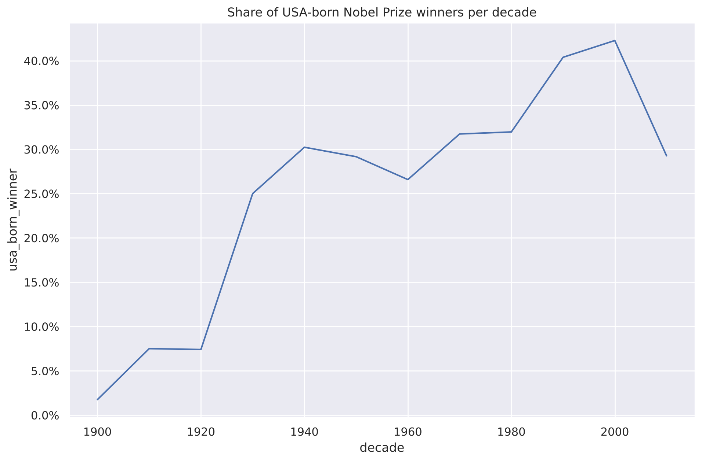
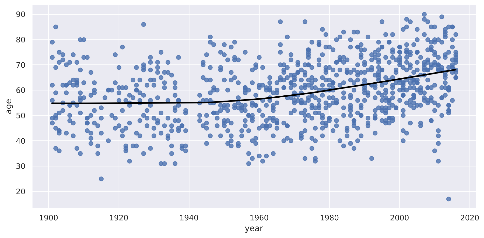

# 🏅 A Visual History of Nobel Prize Winners

> **Exploratory Data Analysis · Time Series · Data Visualization**

Who wins the Nobel Prize? This project explores **911 Nobel Prizes from 1901 to 2016**: nationality, gender, repeat winners and how old laureates are when they receive the prize.

---

## 🧩 Problem Statement

This project answers:
- Which **countries** and **genders** dominate the Nobel Prize?
- When did the **USA** start to dominate?
- Who was the **first woman** to win, and who won **more than once**?
- How **old** are laureates, and has that changed over time?

---

## 📊 Dataset

| Records | Period | Features |
|---|---|---|
| 911 prizes | 1901 – 2016 | `year`, `category`, `prize`, `prize_share`, `laureate_type`, `full_name`, `birth_date`, `birth_country`, `sex`, `organization_name` and more |

---

## 🛠️ Tech Stack


---

## 🔬 Methodology

1. **Overview:** number of prizes, prizes by sex and top 10 birth countries
2. **USA dominance:** share of USA-born winners per decade
3. **Gender gap:** share of female winners per decade and category
4. **Firsts and repeats:** first female laureate and laureates with two or more prizes
5. **Age analysis:** age at award (`year − birth year`), trend over time with a LOWESS fit, overall and per category
6. **Extremes:** oldest and youngest winners

---

## 📈 Key Findings

- 🌍 USA-born laureates lead with **259 prizes**, ahead of the UK (85) and Germany (61).
- 📈 The USA share rose from under 2 % in the 1900s to a peak of **42 % in the 2000s**.
- ♀️ Only **49 prizes** went to women, compared with 836 to men (the rest went to organizations).
- 🥇 **Marie Curie** was the first woman to win (Physics, 1903) and won again in Chemistry (1911). Other repeat winners include Linus Pauling, John Bardeen, Frederick Sanger, the Red Cross and UNHCR.
- 🎂 Laureates are getting **older** over time. The oldest was **Leonid Hurwicz (90, Economics 2007)**, the youngest **Malala Yousafzai (17, Peace 2014)**.

<p>
  
  
</p>

---

## 📁 Project Structure

```
A-Visual-History-of-Nobel-Prize-Winners/
├── notebook.ipynb        # Full analysis
├── datasets/
│   └── nobel.csv         # 911 prizes, 1901–2016
└── images/               # Plots exported from the notebook
```

---

## 💡 What I Learned

- Turning a yes/no column into a **proportion per group** with `groupby().mean()`
- Building decade bins and plotting **trends over time**
- Using **LOWESS** smoothing to show a trend without assuming it is linear

*Guided project from DataCamp.*
