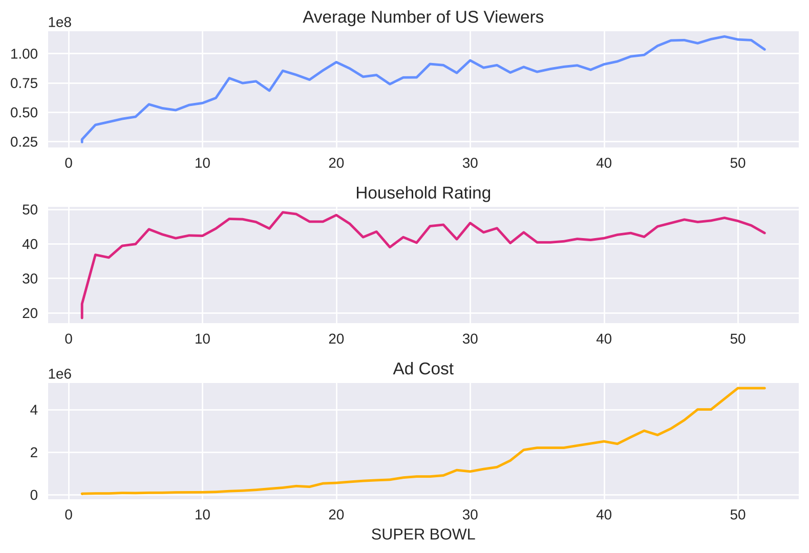
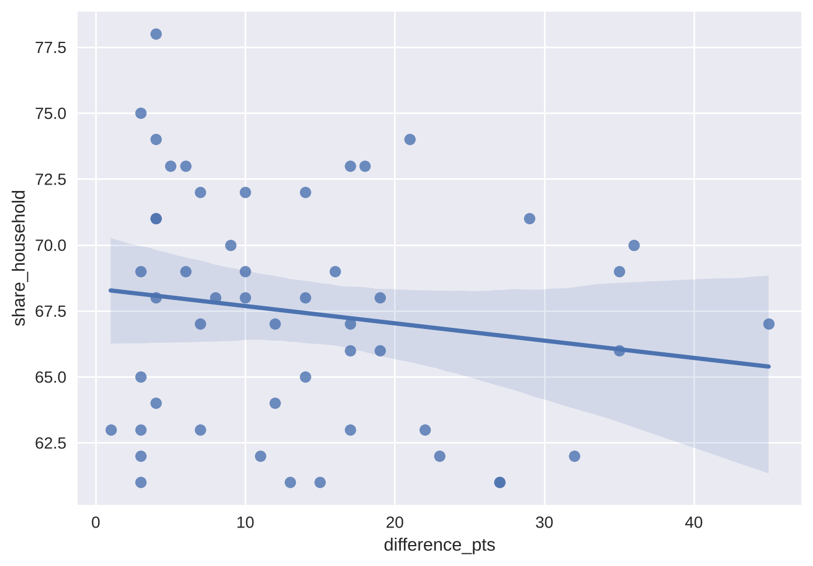

# 🏈 Super Bowl TV Data Analysis

> **Exploratory Data Analysis · Data Cleaning · Data Visualization**

The Super Bowl is one of the most-watched TV events in the US. This project combines game results, TV ratings and halftime show data for **52 Super Bowls** to see how game quality, viewership, ad prices and halftime shows are connected.

---

## 🧩 Problem Statement

This project answers:
- How are **combined points** and **point differences** distributed?
- Do **blowouts** make viewers switch off?
- How have **viewers**, **household ratings** and **ad costs** developed over time?
- Who has the most **halftime show** appearances and performed the most songs?

---

## 📊 Dataset

| Dataset | Description |
|---|---|
| `super_bowls.csv` | Game results: teams, quarterbacks, coaches, points, attendance |
| `tv.csv` | TV data per Super Bowl: network, average viewers, household rating and share, ad cost |
| `halftime_musicians.csv` | Halftime show performers and number of songs |

**Data quality:** `total_us_viewers` and `rating_18_49` are only available for 15 of 53 rows, and `share_18_49` for 6, so the analysis uses `avg_us_viewers` and household ratings.

---

## 🛠️ Tech Stack


---

## 🔬 Methodology

1. **Data quality check** with `info()` to find missing values
2. **Distributions** of combined points and point differences, with the highest/lowest scoring games, the closest game and the biggest blowouts
3. **Regression plot** of point difference vs. household share (Super Bowl I excluded, as it aired on two networks)
4. **Time series** of average viewers, household rating and ad cost
5. **Halftime analysis:** appearances per musician and songs per performance (marching bands excluded)

---

## 📈 Key Findings

- 🔢 Super Bowls average about **47 combined points**; about half of all games are decided by 10 points or fewer.
- 🤏 The closest game was **Super Bowl XXV** (Giants 20 : 19 Bills).
- 📺 There is only a **weak negative relationship** between point difference and household share (r ≈ −0.16): blowouts may cost some viewers, but the evidence is thin.
- 💰 Average viewers grew to over **100 million**, and ad costs rose from **$42,500** (Super Bowl I) to **$5 million** (Super Bowl 52). Viewers grew before ad prices did.
- 🎤 The **Grambling State University Tiger Marching Band** has the most halftime appearances (6). **Justin Timberlake** performed the most songs in one show (11, Super Bowl 52), while most non-band musicians perform 1–3 songs.

<p>
  
  
</p>

---

## 📁 Project Structure

```
Analyzing-TV-Data/
├── notebook.ipynb              # Full analysis
├── datasets/
│   ├── super_bowls.csv
│   ├── tv.csv
│   └── halftime_musicians.csv
└── images/                     # Plots exported from the notebook
```

---

## 💡 What I Learned

- Spotting **sparse columns** early and choosing metrics that are complete
- Joining several sources to answer one question
- Not over-reading a **weak regression trend**

*Guided project from DataCamp.*
