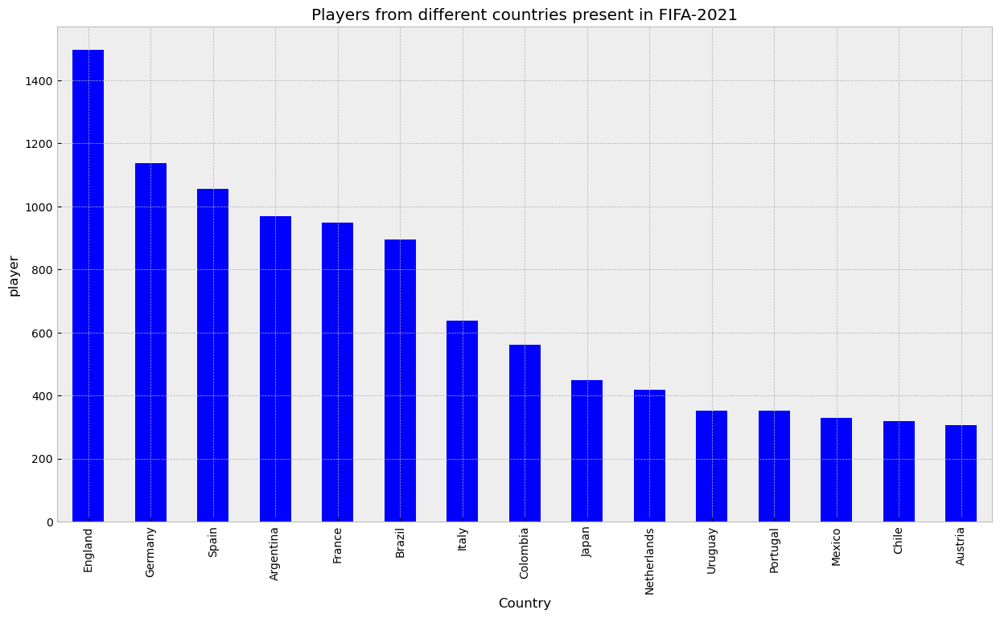
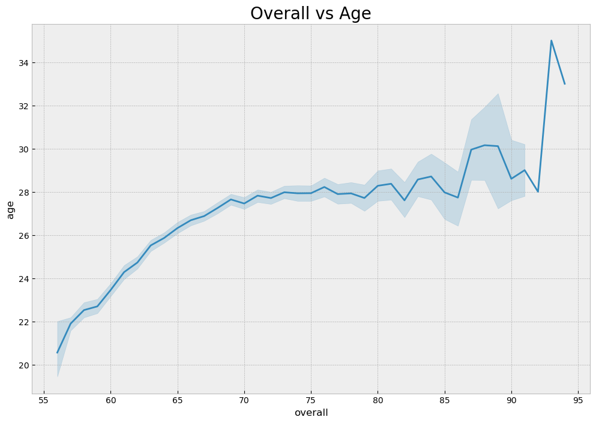

# ⚽ FIFA 21 Player Analysis

> **Exploratory Data Analysis · Data Visualization · pandas**

An exploratory analysis of **17,981 players** from the video game FIFA 21: where they come from, how old they are, which clubs have the youngest and oldest squads, and how ratings change with age.

---

## 🧩 Problem Statement

This project answers:
- Which **countries** have the most players in the game?
- What does the **age distribution** look like, and who are the youngest and oldest players?
- Which **clubs** have the youngest and oldest squads, and the highest-rated players?
- How do **overall rating** and **potential** relate to age?

---

## 📊 Dataset

| Records | Features |
|---|---|
| 17,981 players | `player_id`, `name`, `nationality`, `position`, `overall`, `age`, `hits`, `potential`, `team` |

No missing values.

---

## 🛠️ Tech Stack


---

## 🔬 Methodology

1. **Data quality check:** shape and null values
2. **Players by country:** top 15 nations
3. **Age analysis:** distribution, youngest and oldest players, average squad age per club
4. **Top players per position:** ST, CDM, CB and GK
5. **Helper functions** to look up a single player or a national pool (e.g. Germany)
6. **Ratings vs. age:** line plots for overall and potential, top clubs by highest overall
7. **Choropleth maps** (Plotly) of total overall and potential ratings per country

---

## 📈 Key Findings

- 👶 The youngest players are **17** (e.g. Eduardo Camavinga), the oldest **43**.
- 🧒 Youngest squad on average: **UCD AFC (21.0 years)**; oldest: **Beijing Renhe FC (31.3 years)**.
- ⭐ Highest-rated players: **Lionel Messi (94)**, **Cristiano Ronaldo (93)**, **Neymar Jr (92)**.
- 📉 Players with a higher **overall** rating tend to be older, while players with the highest **potential** tend to be younger: young players are rated on what they can become, experienced players on what they already are.

<p>
  
  
</p>

---

## 📁 Project Structure

```
FIFA-21-EDA/
├── FiFA-2021.ipynb          # Full analysis
├── FIFA 2021 Complete.xlsx  # Dataset (17,981 players)
└── images/                  # Plots exported from the notebook
```

---

## 💡 What I Learned

- Using `groupby` and `value_counts` to answer ranking questions quickly
- Writing small **helper functions** for repeated lookups
- Building interactive **choropleth maps** with Plotly
