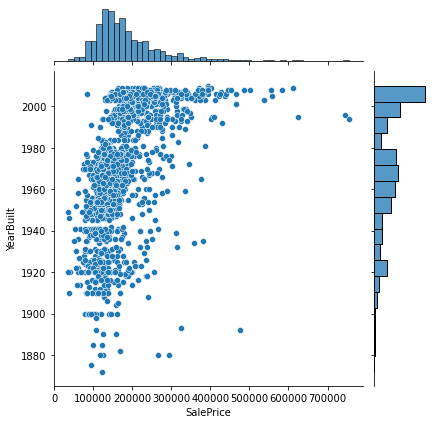
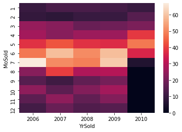

# 🏠 House Price EDA

> **Exploratory Data Analysis · Descriptive Statistics · Data Visualization**

An exploratory analysis of **1,460 house sales**, combining non-graphical statistics with a broad set of seaborn visualizations to understand what drives sale prices.

---

## 🧩 Problem Statement

Before building any price model, you need to understand the data. This project answers:
- How are **sale prices** distributed, and where are the outliers?
- How do price and **year built**, **lot size** and **central air** relate?
- **When** during the year are most houses sold?

---

## 📊 Dataset

| Records | Features | Target |
|---|---|---|
| 1,460 houses | 81 columns (e.g. `LotFrontage`, `LotArea`, `OverallQual`, `YearBuilt`, `CentralAir`, `SaleCondition`, `MoSold`, `YrSold`) | `SalePrice` |

---

## 🛠️ Tech Stack


---

## 🔬 Methodology

### 1. Non-graphical EDA
Data types, `describe()`, correlation matrix, and central tendency and spread of `SalePrice` (mean, median, mode, variance, standard deviation, quartiles), plus covariance and correlation between `LotArea` and `OverallQual`.

### 2. Graphical EDA
Histogram, 2D histogram, box plot, violin plot, count plot, line plot, scatter and bubble plot, pair plot, joint plot and heat map.

---

## 📈 Key Findings

| SalePrice | Value |
|---|---|
| Mean | $180,921 |
| Median | $163,000 |
| Std. deviation | $79,443 |
| Min / Max | $34,900 / $755,000 |
| IQR (Q1–Q3) | $129,975 – $214,000 |

- 📈 Prices are **right-skewed**: the mean is well above the median, pulled up by a few very expensive houses.
- 🏗️ Newer houses tend to sell for more; houses **without central air** are mostly older and cheaper.
- 📅 Sales peak in **May to July** every year.
- 🔗 Lot area and overall quality are only weakly correlated (r ≈ 0.11).

<p>
  
  
</p>

---

## 📁 Project Structure

```
House-price-EDA/
├── House-price-EDA.ipynb   # Full analysis
├── house_price.csv         # Dataset (1,460 houses)
└── images/                 # Plots exported from the notebook
```

---

## 💡 What I Learned

- Choosing the **right chart** for the question: distribution, comparison, relationship or time pattern
- Reading skew and outliers from **mean vs. median** and box/violin plots
- Using `hue` to add a third variable (e.g. central air) to a plot
