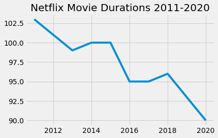
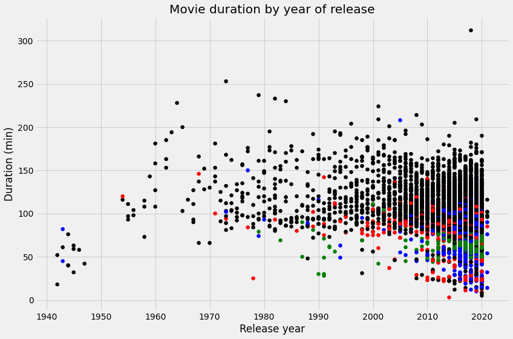

# 🎬 Investigating Netflix Movies

> **Exploratory Data Analysis · Data Visualization · pandas**

Are Netflix movies getting shorter? A first look at the average movie length from 2011 to 2020 suggests yes, but a closer look at the full catalogue shows the answer is more complicated.

---

## 🧩 Problem Statement

A friend's summary data shows the average movie duration dropping from **103 minutes (2011)** to **90 minutes (2020)**. This project checks whether that trend holds up when using the full Netflix dataset.

---

## 📊 Dataset

| Dataset | Description |
|---|---|
| Summary data | Average movie duration per year, 2011–2020 |
| `netflix_data.csv` | Netflix titles with `type`, `title`, `country`, `genre`, `release_year`, `duration` |
| `color_data.csv` | Helper data for plot colours |

---

## 🛠️ Tech Stack


---

## 🔬 Methodology

1. Built a DataFrame from the summary data and plotted the yearly averages
2. Loaded the full dataset and **filtered for movies only**
3. Plotted **duration vs. release year** for every movie
4. Inspected the shortest movies and found many are not feature films
5. **Colour-coded genres** (Children, Documentaries, Stand-Up, others) to see where the short titles come from

---

## 📈 Key Findings

- 📉 The summary data shows a clear drop in average length (103 → 90 minutes).
- 🔍 In the full dataset, many short titles are **children's movies, documentaries and stand-up specials**, which cluster at the bottom of the plot.
- ⚖️ **Conclusion:** we cannot say for certain that movies are getting shorter. Genre mix is a confounder, and further statistical analysis would be needed.

<p>
  
  
</p>

---

## 📁 Project Structure

```
Investigating-Netflix-Movies-and-Guest-Stars-in-The-Office/
├── notebook.ipynb        # Full analysis
├── datasets/
│   ├── netflix_data.csv
│   └── color_data.csv
└── images/               # Plots exported from the notebook
```

---

## 💡 What I Learned

- A trend in an aggregate can disappear or change once you look at the **underlying records**
- Using colour as a third dimension to spot **confounding variables**
- Being careful not to draw conclusions that the data cannot support

*Guided project from DataCamp.*
