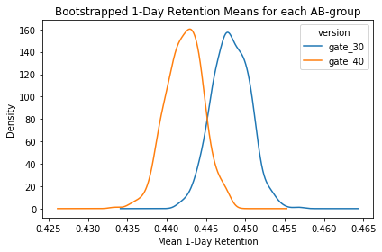
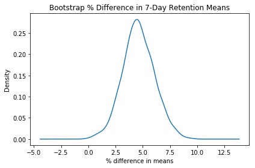

# 🐱 Mobile Games A/B Testing with Cookie Cats

> **A/B Testing · Bootstrapping · Product Analytics**

Should the first "gate" in the mobile puzzle game **Cookie Cats** move from level 30 to level 40? This project analyses a real A/B test with **90,189 players** and uses bootstrapping to decide whether the change hurts player retention.

---

## 🧩 Problem Statement

In Cookie Cats, players hit gates that force them to wait or pay before they can continue. The game studio tested moving the first gate from **level 30** (control) to **level 40**.

This project answers:
- Does the gate position change **1-day** and **7-day retention**?
- How **certain** can we be that the difference is real and not noise?
- Should the gate be moved?

---

## 📊 Dataset

| Group | Players | Description |
|---|---|---|
| `gate_30` | 44,700 | Control: gate at level 30 |
| `gate_40` | 45,489 | Treatment: gate moved to level 40 |

**Features:** `userid`, `version`, `sum_gamerounds` (rounds played in the first 14 days), `retention_1`, `retention_7`

---

## 🛠️ Tech Stack


---

## 🔬 Methodology

### 1. Exploratory Analysis
Checked group sizes and the distribution of game rounds played in the first week. Many players install the game and play very few rounds, while a small group gets hooked.

### 2. Retention by Group
Calculated 1-day and 7-day retention for both groups.

### 3. Bootstrapping
Resampled the dataset **500 times** with replacement to build distributions of the mean retention per group, then calculated the **% difference** between the groups and the probability that it is above 0.

---

## 📈 Key Findings

| Metric | gate_30 | gate_40 | P(gate_30 better) |
|---|---|---|---|
| 1-day retention | 44.8 % | 44.2 % | 95.6 % |
| 7-day retention | 19.0 % | 18.2 % | 100 % |

- 📉 Moving the gate to level 40 **lowers retention**, and the effect is stronger after 7 days, when more players have reached the gate.
- ✅ **Recommendation: keep the gate at level 30.**

<p>
  
  
</p>

---

## 📁 Project Structure

```
Mobile-Gmaes-AB-Testing-with-Cookie-Cats/
├── notebook.ipynb          # Full analysis
├── datasets/
│   └── cookie_cats.csv     # A/B test data (90,189 players)
└── images/                 # Plots exported from the notebook
```

---

## 💡 What I Learned

- How to evaluate an A/B test on a **product metric** (retention) instead of only comparing averages
- Using **bootstrapping** to quantify uncertainty without strong distribution assumptions
- Why the **time window** matters: the effect only becomes clear once enough users have been exposed to the change

*Guided project from DataCamp.*
