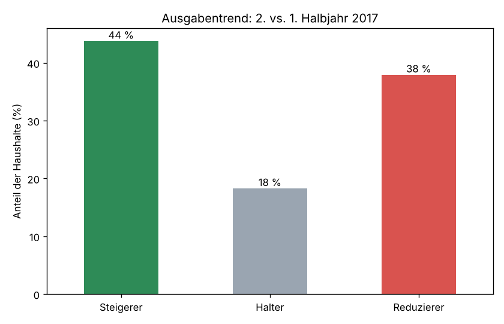
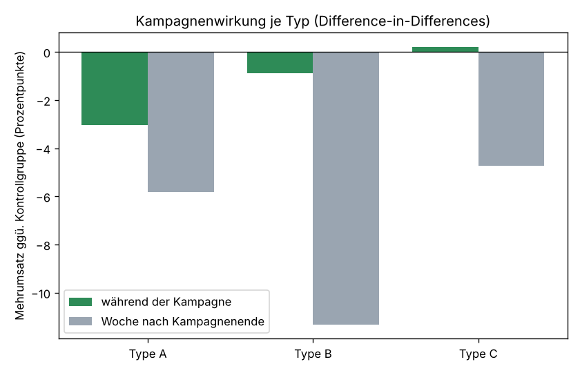
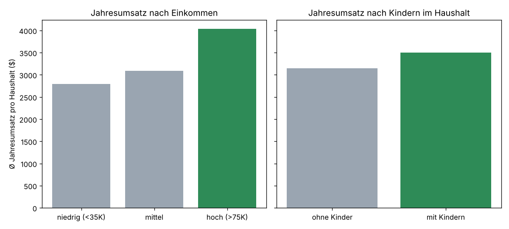

# 🛒 Retail Customer Analytics – "GreenValley Retail"

> **Customer Segmentation · Campaign Evaluation · Difference-in-Differences**

"GreenValley Retail" is a grocery retailer whose growth has stalled. It has a full year of transaction, demographic and campaign data but barely uses it. This project uses **1.47 million transactions from 2,469 households (2017)** to answer three questions: which customers are growing or shrinking, whether the direct-marketing campaigns actually work, and how income and children change spending.

*The concept was developed with Timur Manuev and Mohamed Saci Hameurreras in the Customer Experience course (Prof. Dr. Marek Opuszko, EAH Jena). The analysis in this folder was implemented individually afterwards.*

---

## 🧩 Problem Statement

1. **Spending trend:** How many households increase, hold or reduce their spending over the year (*Steigerer / Halter / Reduzierer*)?
2. **Campaign effectiveness:** Do campaigns of Type A, B and C raise spending, compared with households that were not targeted?
3. **Demographics:** How do spending and category preferences differ between high- (> $75K) and low-income (< $35K) households, and between households with and without children?

---

## 📊 Dataset

[84.51° Complete Journey 2.0](https://github.com/bradleyboehmke/completejourney) (Dunnhumby / 84.51°, licence CC0), calendar year 2017.

| Table | Rows | Content |
|---|---|---|
| `transactions` | 1,468,773 | Household, product, basket, sales value, timestamp |
| `demographics` | 801 | Age, income, household size and composition, children |
| `products` | 92,331 | Department, category, brand |
| `campaigns` / `campaign_descriptions` | 6,589 / 27 | Targeted households, campaign type, start and end date |
| `coupon_redemptions` | 2,102 | Redeemed coupons per household and campaign |

The data is not stored in this repository; `download_data.py` loads it into `data/`.

---

## 🛠️ Tech Stack


---

## 🔬 Methodology

### 1. Spending trend segmentation
Spending in the first half of 2017 (Jan–Jun) compared with the second half (Jul–Dec). Only **1,684 consistently active households** (purchases in at least 10 of 12 months) are included, so that households joining or leaving during the year do not look like growth or decline.
- **Steigerer:** more than +10 %
- **Halter:** between −10 % and +10 %
- **Reduzierer:** less than −10 %

### 2. Campaign effectiveness (Difference-in-Differences)
For each of the **19 campaigns** whose time window lies fully within 2017: average weekly spending of targeted households in the 4 weeks **before** the campaign vs. **during** the campaign and in the **week after** it ends. The same change for all non-targeted households serves as the **control group**, so that seasonal effects (e.g. holidays) cancel out. Effect = change of the target group minus change of the control group (percentage points). Additionally: share of targeted households that redeemed at least one coupon.

### 3. Demographics
Annual spending per household for income groups and for households with/without children, tested with **Welch's t-test**. Category preferences compared as **share of the basket** per group.

---

## 📈 Key Findings

### 1. Steigerer, Halter, Reduzierer

| Segment | Households | Share | Ø H1 → Ø H2 | Median change |
|---|---|---|---|---|
| Steigerer | 737 | 44 % | $990 → $1,472 | +44 % |
| Halter | 308 | 18 % | $1,531 → $1,541 | 0 % |
| Reduzierer | 639 | 38 % | $1,385 → $899 | −32 % |

- 🔄 Only **18 %** of active households keep their spending stable: customer value is constantly moving in both directions.
- 💸 Steigerer add about **$356K** in the second half, Reduzierer lose about **$311K**. Retaining the Reduzierer is worth almost as much as the growth from the Steigerer.
- ⚠️ Steigerer started at a lower level and Reduzierer at a higher one, so part of the movement is likely **regression to the mean**, not a true change in loyalty.

### 2. Campaigns

| Type | Campaigns | Ø targeted households | Effect during campaign | Effect week after | Coupon redemption |
|---|---|---|---|---|---|
| Type A | 4 | 912 | −3.0 pp | −5.8 pp | 15.4 % |
| Type B | 12 | 142 | −0.9 pp | −11.3 pp | 6.6 % |
| Type C | 3 | 100 | +0.2 pp | −4.7 pp | 8.5 % |

- 📉 **No campaign type shows a measurable spending uplift** compared with the control group (no effect significantly above 0).
- 🎟️ Type A reaches the most households and has the highest coupon redemption, but redemptions alone do not translate into more total spending: coupons may mainly discount purchases customers would have made anyway.
- ⚠️ Targeted households were **not randomly selected**, so the comparison can be biased. A proper test needs a randomized hold-out group.

### 3. Demographics

| Comparison | Ø annual spending | Difference | p-value |
|---|---|---|---|
| High income (> $75K, n = 225) vs. low income (< $35K, n = 212) | $4,033 vs. $2,798 | **+44 %** | < 0.001 |
| With children (n = 288) vs. without children (n = 513) | $3,500 vs. $3,150 | **+11 %** | 0.043 |

- 🍷 High-income households spend a larger share on **wine, berries, cheese and salad mix**; low-income households more on **beef, soft drinks, cigarettes, frozen meals and frozen pizza**.
- 👶 Households with children spend more on **diapers, cereal, frozen meat and baked sweets**; households without children more on **wine, beer and cigarettes**.

<p>
  
  
  
</p>

---

## 💡 Recommendations

1. **Retention before acquisition:** run a win-back program for Reduzierer, as their lost revenue nearly equals the Steigerer's growth.
2. **Fix campaign measurement first:** introduce a randomized control group for every campaign before increasing the budget.
3. **Segment-specific assortment:** premium fresh and wine offers for high-income households, family packs and children's products for households with kids.

---

## ⚠️ Limitations

- Demographics are only available for 801 of 2,469 households.
- The data covers a single year, so seasonal and long-term effects cannot be fully separated.
- Online channel data (website visits, online store) from the original course project is not part of the public dataset.

---

## 📁 Project Structure

```
Retail-Customer-Analytics-Complete-Journey/
├── download_data.py   # Downloads the Complete Journey tables into data/
├── analysis.py        # Segmentation, campaign DiD, demographics, plots
└── images/            # Plots created by analysis.py
```

**Run:** `pip install pandas pyreadr scipy matplotlib` → `python download_data.py` → `python analysis.py`

---

## 💡 What I Learned

- Defining segments so that **data artefacts** (customers joining or leaving) do not create fake trends
- Using a **control group** (Difference-in-Differences) instead of a simple before/after comparison
- Reporting a **null result** honestly and turning it into a concrete recommendation
