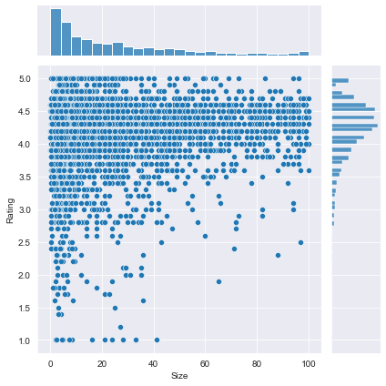
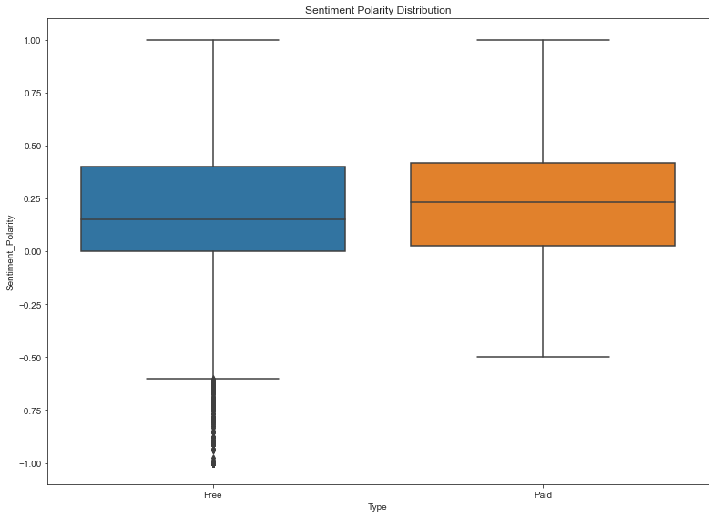

# 📱 The Android App Market on Google Play

> **Data Cleaning · Market Analysis · Sentiment Analysis**

A market analysis of **9,659 Google Play apps** across **33 categories**: app ratings, size and price, free vs. paid apps, and the sentiment of user reviews.

---

## 🧩 Problem Statement

This project answers:
- Which **categories** dominate the market?
- How are **ratings** distributed, and do app **size** and **price** affect them?
- How do developers **price** apps in different categories?
- Are **free or paid** apps downloaded more, and how do users feel about each?

---

## 📊 Dataset

| Dataset | Description |
|---|---|
| `apps.csv` | 9,659 unique apps with `Category`, `Rating`, `Size`, `Installs`, `Type`, `Price` and more |
| `user_reviews.csv` | User reviews with sentiment labels and polarity scores |

---

## 🛠️ Tech Stack


---

## 🔬 Methodology

1. **Data cleaning:** removed duplicates and special characters (`+`, `,`, `$`) from `Installs` and `Price`
2. **Type correction:** converted `Installs` and `Price` to numeric
3. **Category analysis:** number of apps per category
4. **Rating distribution:** histogram of app ratings
5. **Size and price vs. rating:** joint plots for categories with at least 250 apps
6. **Pricing by category:** strip plots for popular categories, then **filtered out "junk" apps** priced at $100 or more
7. **Free vs. paid:** downloads compared on a log scale
8. **Review sentiment:** joined reviews with apps and compared sentiment polarity for free and paid apps

---

## 📈 Key Findings

- ⭐ The **average app rating is 4.17**; most apps are rated well.
- 📦 Most top-rated apps (rating above 4) are between **2 MB and 20 MB**, and the vast majority of apps cost **under $10**.
- 💸 Many of the most expensive apps are **"junk" apps** with no real purpose; after filtering them out, most paid apps cost only a few dollars.
- ⬇️ Paid apps have fewer installs than free apps, though the gap is smaller than expected.
- 💬 Free apps receive many harsh reviews, while reviews of **paid apps** are almost never extremely negative and have a slightly higher median polarity.

<p>
  
  
</p>

---

## 📁 Project Structure

```
The Android-App-Market-on-Google-Play/
├── notebook.ipynb        # Full analysis
├── datasets/
│   ├── apps.csv
│   └── user_reviews.csv
└── images/               # Plots exported from the notebook
```

---

## 💡 What I Learned

- Cleaning **string-formatted numbers** before analysis
- Spotting and removing **outliers that distort** a visualization
- Combining two datasets to add **review sentiment** to a market analysis

*Guided project from DataCamp.*
