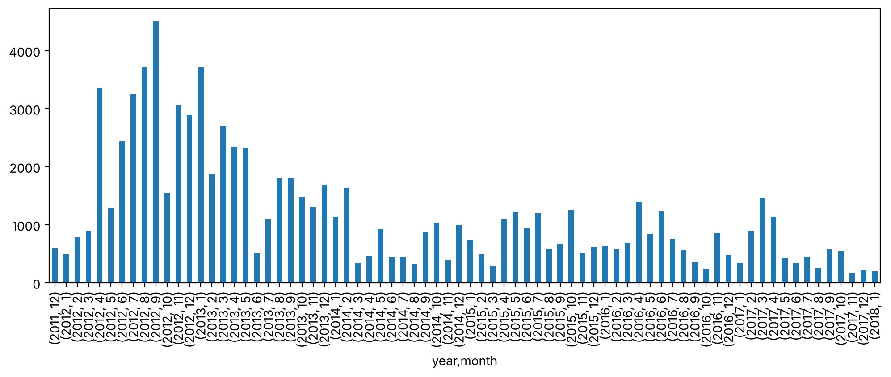
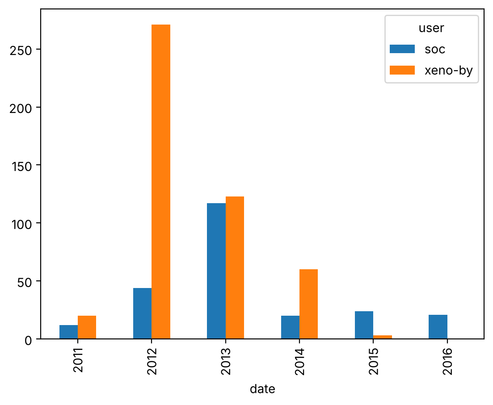

# 🧑‍💻 The GitHub History of the Scala Language

> **Data Wrangling · Time Series · Open Source Analytics**

Who should you ask before changing a file in a large open-source project? This project analyses **6,200 pull requests** from **467 contributors** to the Scala language repository (December 2011 to January 2018) to measure project activity and find the experts for a specific file.

---

## 🧩 Problem Statement

This project answers:
- Is the project still **actively maintained**?
- Is the work spread across many people or done by a **few core contributors**?
- Which files were changed in the **most recent pull requests**?
- Who knows a given file best, and **who is still active** on it?

---

## 📊 Dataset

| Dataset | Description |
|---|---|
| `pulls_2011-2013.csv`, `pulls_2014-2018.csv` | Pull requests: `pid`, `user`, `date` |
| `pull_files.csv` | Files changed by each pull request: `pid`, `file` |

---

## 🛠️ Tech Stack


---

## 🔬 Methodology

1. **Preparation:** combined both pull request files, converted dates to UTC datetimes and merged with the changed files
2. **Activity:** pull requests per month
3. **Contributor distribution:** histogram of pull requests per user
4. **Recent changes:** unique files touched by the last 10 pull requests
5. **File experts:** top contributors and last 10 contributors for `src/compiler/scala/reflect/reify/phases/Calculate.scala`
6. **Two candidates compared:** yearly pull requests of `xeno-by` and `soc`, overall and for that file

---

## 📈 Key Findings

- 📊 Activity peaked in **2012–2013** (over 1,400 pull requests per year) and then settled at around **600–900 per year**: the project is still maintained, but less intensely.
- 👥 Contributions are **highly concentrated**: most users submit only a few pull requests, while core contributors such as `retronym` (1,030) submit hundreds.
- 📁 For `Calculate.scala`, the top contributors are **xeno-by (11)**, **retronym (5)** and **soc (4)**.
- 🔎 `xeno-by` made most of the changes to that file (mainly in 2012), but his overall activity dropped after 2014, while `soc` kept contributing to the project until 2016. **Both are good contacts**, depending on whether you need deep file knowledge or someone who is still active.

<p>
  
  
</p>

---

## 📁 Project Structure

```
The-GitHub-History-of-the-Scala-Language/
├── notebook.ipynb              # Full analysis
├── datasets/
│   ├── pulls_2011-2013.csv
│   ├── pulls_2014-2018.csv
│   └── pull_files.csv
└── images/                     # Plots exported from the notebook
```

---

## 💡 What I Learned

- Combining and merging datasets with `concat` and `merge`
- Working with **timezone-aware datetimes** and grouping by year and month
- Reshaping data with `pivot_table` for side-by-side comparisons

*Guided project from DataCamp.*
