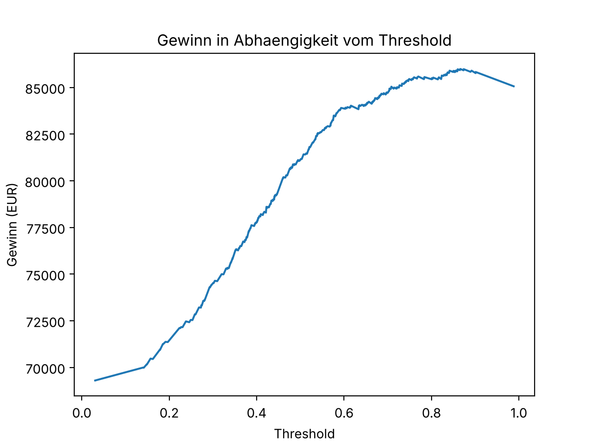
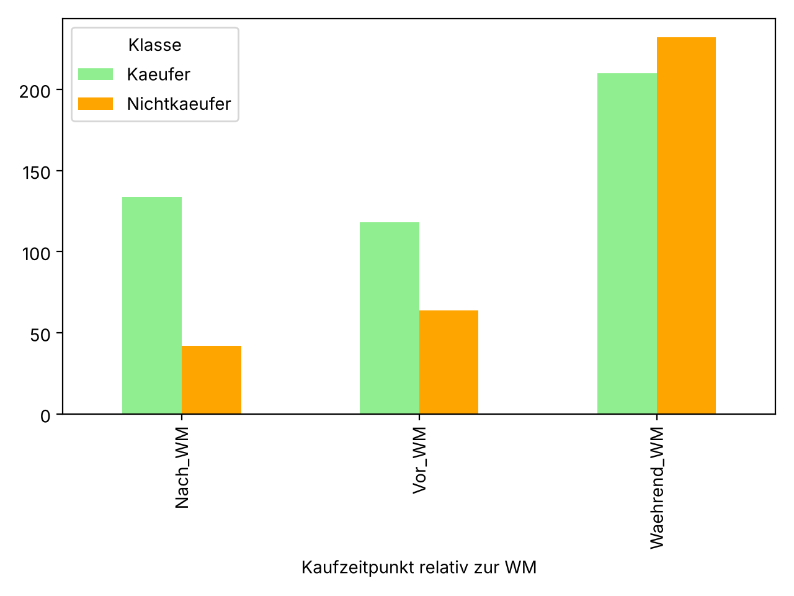
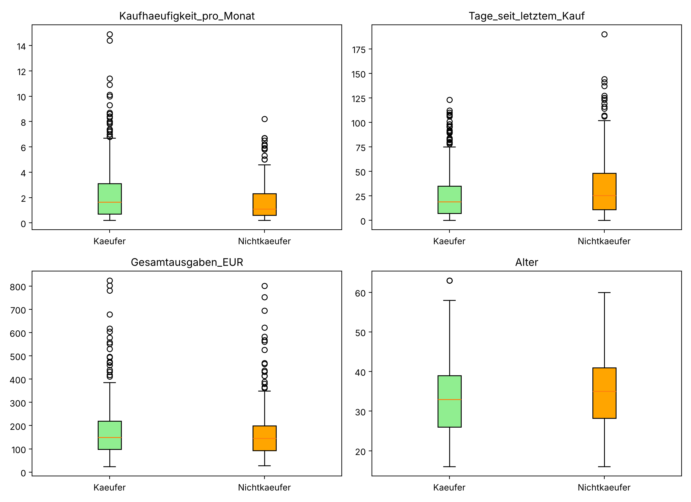
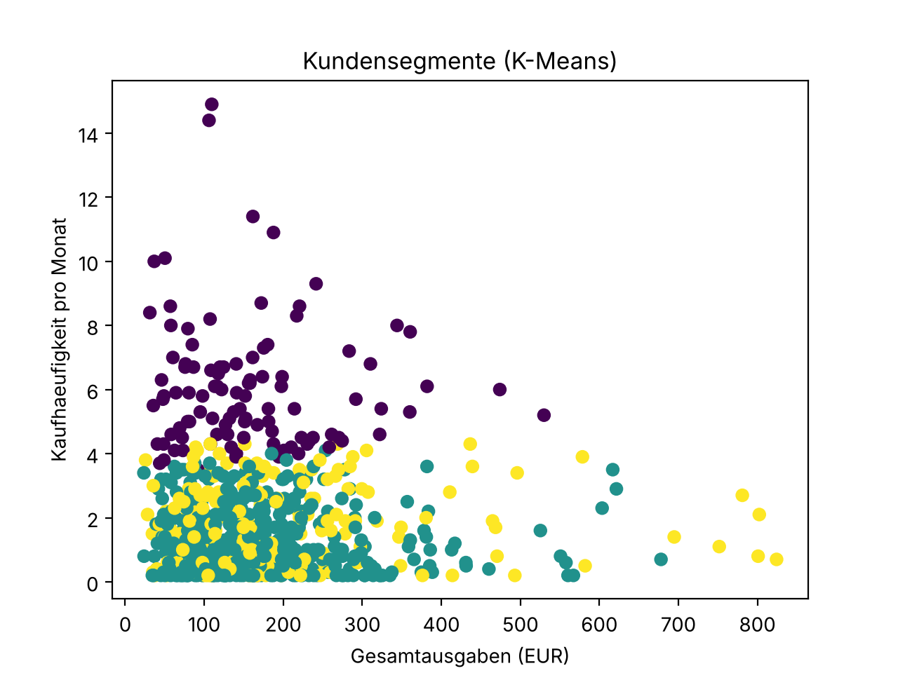

# ⚽ Customer Churn Prediction for a World Cup Sports Shop

> **Classification · Cost-Sensitive Evaluation · Threshold Optimization**

After a FIFA World Cup, many customers of a sports shop stop buying: they were only there for the hype. This project predicts which customers will keep buying, compares six classifiers and chooses the decision threshold that **maximizes profit** instead of accuracy.

*Graded university project (M.Sc. E-Commerce, EAH Jena). The dataset is synthetic and fully reproducible.*

---

## 🧩 Problem Statement

The shop wants to send a **€12 discount code** to customers who are likely to churn, but not waste it on customers who would buy anyway.

This project answers:
- Which customer features differ significantly between **buyers** and **churners**?
- Which model works best, measured in **euros** rather than accuracy?
- Which **probability threshold** gives the highest profit?
- Bonus: which **customer segments** exist?

---

## 📊 Dataset

| Records | Churn rate | Missing values |
|---|---|---|
| 800 customers | 42 % (338 churners, 462 buyers) | `Anzahl_WM_Artikel` (40), `Rabatt_Nutzung_Pct` (48) |

**Features:** `Alter`, `Kaufhaeufigkeit_pro_Monat`, `Gesamtausgaben_EUR`, `Tage_seit_letztem_Kauf`, `Anzahl_WM_Artikel`, `Lieblings_Nationalmannschaft`, `Zahlungsmethode`, `Kaufzeitpunkt_relativ_WM` (before / during / after the World Cup), `Rabatt_Nutzung_Pct`, `Stammkunde_vor_WM`, `Anzahl_Beschwerden`, target `Churn`

The data is generated by `generate_dataset.py` (seed 42) with plausible rules (regular customers stay, World-Cup-only buyers leave, recency and frequency matter) plus random noise, so that the classes are **not perfectly separable**. Missing values were added on purpose to require cleaning.

---

## 🛠️ Tech Stack


---

## 🔬 Methodology

### 1. Cleaning
Missing values filled with the **median**. Positive class = **buyer** (`Churn = 0`).

### 2. Descriptive statistics and significance tests
Box plots, histogram and bar chart by class; **Welch's t-test** for numerical features, **chi-square test** for categorical features.

### 3. Model comparison
Logistic Regression, Naive Bayes, Decision Tree, k-Nearest Neighbors, Neural Network (MLP) and Random Forest, evaluated with **10-fold cross-validation** (`cross_val_predict`).

### 4. Cost matrix
| Outcome | Meaning | Value per customer |
|---|---|---|
| TP | Buyer recognized, no discount needed | €150 |
| FN | Buyer missed, gets discount and buys | €138 (150 − 12) |
| FP | Churner predicted as buyer, no code sent | €0 |
| TN | Churner recognized, code sent | €63 |

### 5. Threshold optimization
Profit calculated for every threshold on the ROC curve of the logistic regression; the threshold with the highest profit wins.

### 6. Bonus: K-Means clustering
Four standardized behavioral features, 3 clusters, evaluated with the Calinski-Harabasz score.

---

## 📈 Key Findings

**Significant drivers (p < 0.05):** purchase frequency, days since last purchase, regular customer before the World Cup, purchase timing, age, discount usage and favorite national team.

| Group | Churn rate |
|---|---|
| Bought only **during** the World Cup | 52 % |
| Bought **before** the World Cup | 35 % |
| Also bought **after** the World Cup | 24 % |
| Regular customer before the World Cup | 22 % (vs. 53 % for new customers) |

**Model comparison (10-fold CV, threshold 0.5):**

| Model | Accuracy | TPR | FPR | Profit |
|---|---|---|---|---|
| Logistic Regression | **0.677** | 0.74 | 0.41 | €80,460 |
| Naive Bayes | 0.655 | 0.69 | 0.39 | **€80,499** |
| Random Forest | 0.664 | 0.77 | 0.48 | €79,053 |
| Neural Network | 0.635 | 0.67 | 0.41 | €79,950 |
| Decision Tree | 0.604 | 0.66 | 0.47 | €78,732 |
| k-Nearest Neighbors | 0.531 | 0.65 | 0.63 | €75,282 |

**Threshold optimization (Logistic Regression):**
- 🎯 Optimal threshold: **0.87**, profit **€85,989**, i.e. **+€4,812** compared with the default threshold 0.5 on the same model and data.
- 💡 **Key insight:** with this cost matrix a discount is cheap (€12) and a missed churner is expensive, so the model should only label a customer as "buyer" when it is very sure. At the default threshold, every model earns **less** than simply sending the code to everyone (€85,050). Only the optimized threshold beats that baseline. Choosing the threshold by business value matters more than choosing the model by accuracy.

**Clusters:** a frequent-buyer segment (about 6 purchases per month) has the lowest churn rate (27 %), while a segment with long inactivity and many World Cup items has the highest (48 %).

<p>
  
  
</p>
<p>
  
  
</p>

---

## ⚠️ Limitations

- The dataset is **synthetic**, so the results show the method, not real customer behavior.
- The threshold is optimized on the **same data** the logistic regression was trained on, following the course solution. In production, the threshold should be chosen on out-of-sample predictions (e.g. `cross_val_predict(..., method="predict_proba")`).

---

## 📁 Project Structure

```
WM-Sportartikel-Churn-Prediction/
├── generate_dataset.py           # Creates the synthetic dataset (seed 42)
├── ecommerce_churn_dataset.csv   # 800 customers
├── analysis.py                   # Cleaning, tests, models, cost matrix, threshold, clustering
└── images/                       # Plots created by analysis.py
```

**Run:** `python generate_dataset.py` (optional, recreates the CSV) → `python analysis.py`

---

## 💡 What I Learned

- Evaluating classifiers by **business value** with a cost matrix instead of accuracy alone
- Why the **decision threshold** can matter more than the choice of model
- Designing a synthetic dataset that is realistic, noisy and not perfectly separable
- Writing code that is simple enough to explain line by line in a live defense
