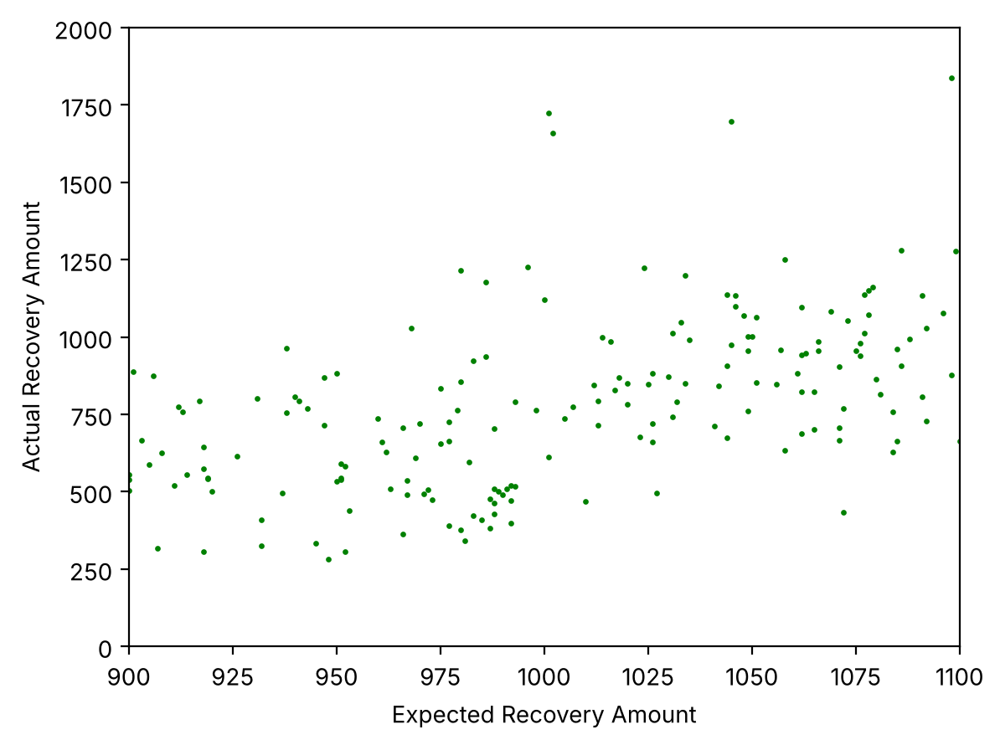
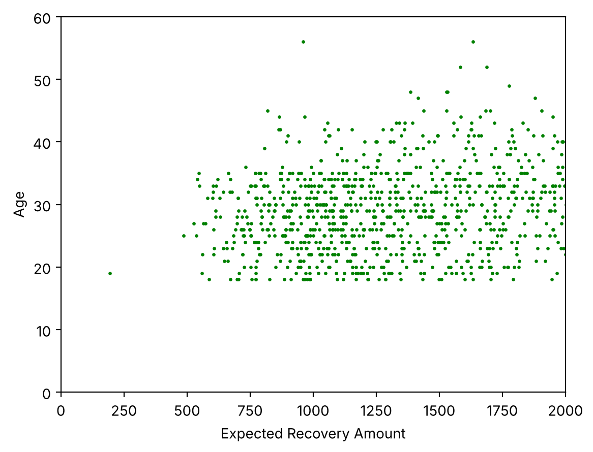

# 🏦 Which Debts Are Worth the Bank's Effort?

> **Regression Discontinuity · Hypothesis Testing · Causal Inference**

A bank uses a more intensive (and more expensive) recovery strategy for charged-off debts with an expected recovery amount of **$1,000 or more**. Does the extra effort pay off? This project uses a **regression discontinuity design** on **1,882 accounts** to estimate the causal effect of the higher strategy.

---

## 🧩 Problem Statement

The higher recovery strategy costs an extra **$50 per customer**. This project answers:
- Are customers just below and just above the $1,000 threshold **comparable** (age, sex)?
- Is there a **jump in actual recovery** at the threshold?
- Is the effect larger than the **$50** cost?

---

## 📊 Dataset

| Records | Features |
|---|---|
| 1,882 accounts | `id`, `expected_recovery_amount`, `actual_recovery_amount`, `recovery_strategy`, `age`, `sex` |

---

## 🛠️ Tech Stack


---

## 🔬 Methodology

### 1. Balance checks around the threshold ($900–$1,100, 183 customers)
- **Age:** Kruskal-Wallis test between Level 0 and Level 1 recovery
- **Sex:** Chi-square test on a contingency table

### 2. Recovery amount
Scatter plot of actual vs. expected recovery and a Kruskal-Wallis test on actual recovery.

### 3. Regression discontinuity
OLS of actual recovery on expected recovery, then with an **indicator for ≥ $1,000** to estimate the jump at the threshold. Repeated with a narrower **$950–$1,050** window as a robustness check.

---

## 📈 Key Findings

| Test / Model | Result |
|---|---|
| Age, Level 0 vs. Level 1 | p = 0.063, no significant difference |
| Sex, Level 0 vs. Level 1 | p = 0.54, no significant difference |
| Actual recovery, Level 0 vs. Level 1 | p < 0.001, significant difference |
| Threshold effect, window $900–$1,100 | **+$278** per customer (p < 0.001) |
| Threshold effect, window $950–$1,050 | **+$287** per customer (p = 0.012) |

- ✅ Customers on both sides of the threshold are similar, so the jump can be attributed to the **recovery strategy**.
- 💰 The higher strategy recovers about **$280 more per customer**, far more than the **$50** it costs. **It is worth the effort.**

<p>
  
  
</p>

---

## 📁 Project Structure

```
Which-Debts-Are-Worth-the-Bank's-Effort/
├── notebook.ipynb        # Full analysis
├── datasets/
│   └── bank_data.csv     # 1,882 charged-off accounts
└── images/               # Plots exported from the notebook
```

---

## 💡 What I Learned

- How a **regression discontinuity design** estimates a causal effect from observational data
- Checking that groups are **comparable** before attributing a difference to a treatment
- Testing **robustness** by changing the analysis window

*Guided project from DataCamp.*
